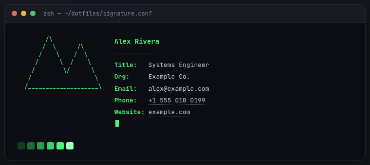
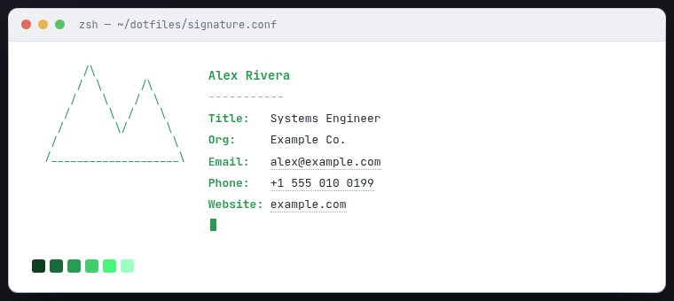
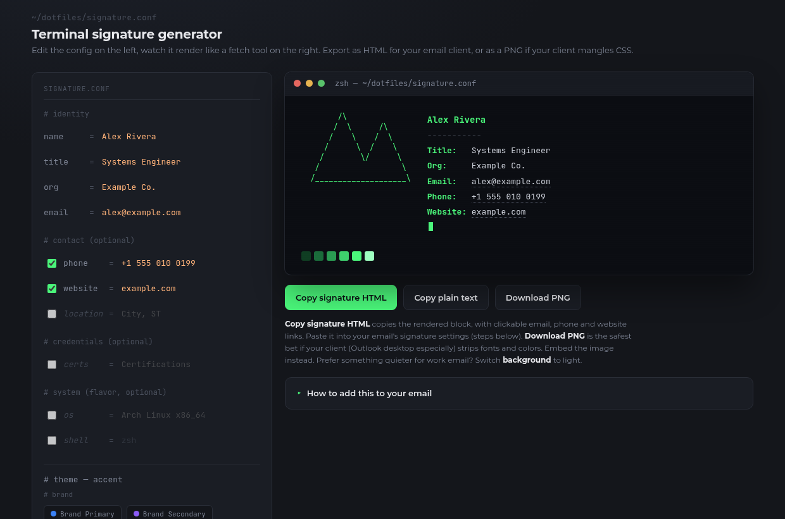

# Email Signature Generator

**[▶ Open the generator](https://kevinsays.github.io/EmailSignatureGenerator/)**. It runs in your browser, with no sign-up and nothing to install.

Make an email signature that looks like a terminal "fetch" readout (think `neofetch`): ASCII logo on the left, `Label: value` rows on the right, and a color strip along the bottom. Choose a dark terminal look or a quieter light version for work email.

| Dark terminal | Light paper |
|---|---|
|  |  |



## How to use it

1. **[Open the generator](https://kevinsays.github.io/EmailSignatureGenerator/)**. You can also download `index.html` and double-click it, since it works offline.
2. Fill in your name, title, organization and email. Tick the boxes to add optional rows like phone, website or location.
3. Pick a color, an ASCII logo and a background (**Dark terminal** or **Light paper**).
4. Export it:
   - **Copy signature HTML**: paste into Gmail, Outlook or Apple Mail. Email, phone and website are clickable links.
   - **Copy plain text**: for plain-text emails and mobile apps.
   - **Download PNG**: a sharp image. Use this when your email app strips colors and fonts (classic Outlook desktop is the usual culprit).
5. Open **How to add this to your email** on the page for step-by-step instructions for Gmail, Outlook (web/new), classic Outlook and Apple Mail.

**Privacy:** everything happens in your browser. Nothing you type is sent anywhere, and there's no tracking.

## Adapting it

Everything you'd want to change is near the top of the `<script>` block in `index.html`.

### Use your organization's brand colors
Edit the `brand` entries in `ACCENTS`:

```js
brand_primary: { name:'Brand Primary', hex:'#3B82F6', group:'brand',
                 ramp:['#0b1e3d','#163a75','#2257ad','#2f6fe0','#3b82f6','#a9c8fb'] },
```

`hex` is the accent color. `ramp` is the six-swatch strip under the preview (dark → light). Rename, add or remove entries freely. To start with your brand color selected, set `accent:` in the `state` line to its key.

### Pre-fill fields for a team
Set `default:` values in `FIELD_DEFS` (e.g. `org`, `website`) so coworkers only need to type their name, title and email. Then host the file somewhere shared.

### Add or remove fields
Add an object to `FIELD_DEFS`:

```js
{ key:'pronouns', label:'pronouns', placeholder:'they/them', default:'',
  optional:true, defaultShow:false, group:'identity (optional)' },
```

Optional fields show up in the preview automatically. Required (non-optional) rows are listed explicitly in `buildModel()`, so add them there too.

### Add your own ASCII logo
Add an array of strings to `LOGOS` and a matching label to `LOGO_LABELS`. Escape backslashes (`\\`). Keep it under ~10 lines so the signature stays compact.

### Change the look
- Signature backgrounds are defined in `STYLES` (`dark` and `light`). Add your own, for example a navy "brand" background. In light mode the accent uses `ramp[2]`, a darker shade, so it stays readable on white.
- Window chrome text (`zsh — ~/dotfiles/signature.conf`) appears in the HTML (`.tpath`) and in `downloadPng()`.
- Page colors are CSS variables in `:root`.
- Fonts: JetBrains Mono for the preview and PNG. The email HTML falls back to `Consolas, Monaco, 'Courier New'` because most clients won't load web fonts.

### Other ideas
- Drop the terminal theme: rewrite `generateEmailHtml()` for a conventional layout and keep the editor/export plumbing.
- Add an `` logo cell (hosted URL) in place of ASCII art for a more corporate signature.
- Make it a team tool: fork it, set your org's defaults, enable GitHub Pages on your fork, and share the link.

## Email client notes
- **Gmail / Outlook web**: paste the HTML copy straight into the signature settings.
- **Outlook desktop / Apple Mail**: results vary. The PNG is the reliable fallback. Link it to your website if you want it clickable.
- The dark style can look heavy in light-mode inboxes. Switch to **Light paper** if that bothers you, and test by sending yourself an email.

## License
MIT. Use it, fork it, rebrand it.
